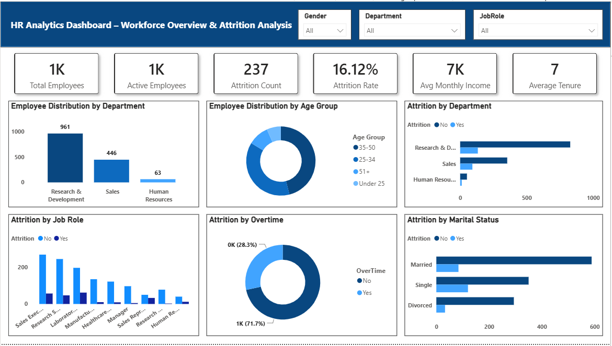

# 👥 HR Analytics – Employee Attrition & Workforce Insights

### End-to-End Data Analytics & Business Intelligence Project

An end-to-end Data Analytics project that analyzes employee workforce data to understand employee distribution, attrition patterns, job satisfaction, overtime, and workforce characteristics.

This project follows a complete analytics workflow using **Python for data preparation, MySQL for data storage and SQL analysis, and Power BI for data modeling, KPI development, and interactive dashboard reporting**.

The final solution provides a **two-page interactive Power BI dashboard** along with key HR insights and practical recommendations to support employee retention and workforce planning.

---

# 📌 Project Overview

Employee attrition is an important challenge for organizations because employee exits can affect workforce stability, recruitment planning, and overall business operations.

Understanding why employees leave and identifying workforce segments with higher attrition can help HR teams make better decisions.

The **HR Analytics – Employee Attrition & Workforce Insights** project transforms employee data into an interactive business intelligence solution.

The project focuses on analyzing:

- Employee workforce distribution
- Employee attrition count and rate
- Department-wise attrition
- Job role-wise attrition
- Employee age groups
- Overtime patterns
- Job satisfaction
- Marital status and workforce demographics
- Employee tenure and monthly income

The final dashboard provides a consolidated view of workforce performance, attrition patterns, and actionable HR recommendations.

---

# 🎯 Business Problem

An organization wants to understand its employee workforce and identify patterns associated with employee attrition.

However, employee information is often difficult to interpret without structured analysis and clear reporting.

The HR team needs an analytics solution to answer questions such as:

- How many employees are currently in the workforce?
- How many employees have left the organization?
- What is the overall employee attrition rate?
- Which departments have higher employee attrition?
- Which job roles experience more employee exits?
- How does attrition differ between overtime and non-overtime employees?
- How does employee satisfaction relate to attrition patterns?
- How does attrition vary across different age groups?
- What actions can HR take to support employee retention?

### Main Business Question

> **How can employee workforce data be analyzed to identify attrition patterns and provide actionable insights that support better HR decisions and employee retention?**

---

# 🛠️ Technology Stack

| Technology | Purpose |
|---|---|
| Python | Data preparation and analysis |
| Pandas | Data manipulation and transformation |
| NumPy | Numerical operations |
| MySQL | Database management |
| SQL | Business analysis and data querying |
| Power BI | Data modeling and interactive dashboard development |
| Power Query | Data transformation |
| DAX | KPI calculations and business measures |
| GitHub | Project documentation and portfolio delivery |

---

# 🔄 Project Workflow

```text
Raw HR Dataset
      ↓
Python Data Exploration & Cleaning
      ↓
Cleaned Employee Dataset
      ↓
MySQL Database
      ↓
SQL Business Analysis
      ↓
Power BI Data Modeling
      ↓
DAX Measures & KPI Development
      ↓
Interactive HR Analytics Dashboard
      ↓
Insights & Recommendations
```

---

# 📊 Dataset Summary

The project uses the **IBM HR Analytics Employee Attrition & Performance** dataset.

**Dataset Source:** [Kaggle – IBM HR Analytics Employee Attrition & Performance](https://www.kaggle.com/datasets/pavansubhasht/ibm-hr-analytics-attrition-dataset)

### Dataset Information

| Attribute | Details |
|---|---|
| Dataset Name | IBM HR Analytics Employee Attrition & Performance |
| Total Records | 1,470 |
| Original Columns | 35 |
| Data Type | Employee workforce data |
| Analysis Area | HR Analytics and Employee Attrition |

### Key Dataset Attributes

- EmployeeNumber
- Age
- Gender
- Department
- JobRole
- MaritalStatus
- MonthlyIncome
- TotalWorkingYears
- YearsAtCompany
- YearsInCurrentRole
- JobSatisfaction
- EnvironmentSatisfaction
- WorkLifeBalance
- OverTime
- Attrition

**Note:** The dataset is fictional and is commonly used for HR analytics and employee attrition analysis. It does not represent actual IBM employee records.

---

# 🐍 Data Preparation Using Python

The raw employee dataset was explored and prepared using Python in a Jupyter Notebook.

### Activities Performed

- Loaded the original HR employee dataset using Pandas.
- Reviewed dataset structure and column information.
- Performed initial data profiling.
- Checked missing values and duplicate records.
- Examined column data types and unique values.
- Reviewed constant and unnecessary columns.
- Prepared the cleaned employee dataset for further analysis.
- Exported the cleaned data as a CSV file.

### Python Libraries Used

```python
import pandas as pd
import numpy as np
```

### Python Notebook

```text
HR_DataSteps.ipynb
```

The complete data preparation workflow is available in the Jupyter Notebook included in this repository.

---

# 🗄️ MySQL Database & SQL Analysis

The cleaned employee dataset was prepared for structured database analysis using MySQL.

SQL was used to explore employee workforce information and generate business-level insights.

### SQL Analysis Areas

- Total employee count
- Active employee count
- Employee attrition count
- Overall attrition rate
- Department-wise employee distribution
- Department-wise attrition
- Job role-wise attrition
- Employee age group analysis
- Overtime and attrition analysis
- Employee tenure analysis
- Average monthly income
- Job satisfaction and attrition patterns

### SQL File

```text
HR_Employee_Analysis.sql
```

The SQL queries are included in the repository for reviewing and understanding the business analysis performed during the project.

---

# 📊 Power BI Data Modeling & DAX

Power BI was used to develop an interactive HR Analytics dashboard.

The employee dataset was prepared for reporting, and DAX measures were created to calculate important workforce KPIs.

### Key DAX Measures

- Total Employees
- Active Employees
- Attrition Count
- Attrition Rate
- Employee Retention Rate
- Average Employee Age
- Average Monthly Income
- Average Tenure
- Average Work Experience
- Overtime Employees
- Overtime Attrition Rate

These measures support workforce reporting and employee attrition analysis.

---

# 📈 Power BI Dashboard

The final Power BI dashboard contains **two interactive pages** designed to provide a complete view of employee workforce distribution, attrition patterns, and HR recommendations.

---

## 📊 Page 1 — HR Analytics Dashboard: Workforce Overview & Attrition Analysis

Provides an overview of employee workforce metrics and attrition patterns across different employee categories.

### Key Performance Indicators (KPIs)

- Total Employees
- Active Employees
- Attrition Count
- Attrition Rate
- Average Monthly Income
- Average Tenure

### Analysis Areas

- Employee Distribution by Department
- Employee Distribution by Age Group
- Attrition by Department
- Attrition by Job Role
- Attrition by Overtime
- Attrition by Job Satisfaction
- Attrition by Marital Status

### Interactive Filters

- Department
- Gender
- Job Role



---

## 💡 Page 2 — HR Insights & Recommendations

This page presents the key findings from the employee analysis and provides practical recommendations to support better HR decision-making.

### Key Focus Areas

- Workforce overview
- Employee attrition observations
- Department-wise attrition patterns
- Job role analysis
- Overtime and employee satisfaction observations
- Workforce demographic patterns
- HR challenges
- Employee retention recommendations

### HR Recommendations

- Develop targeted employee retention strategies.
- Monitor overtime and employee workload.
- Improve employee satisfaction and workplace experience.
- Support career development and learning opportunities.
- Strengthen employee engagement.
- Monitor workforce and attrition KPIs regularly.


---

# 📈 Key Business Insights

The dashboard provides insights into employee workforce distribution and attrition patterns.

### Workforce Overview

- Total Employees: **1,470**
- Active Employees: **1,233**
- Attrition Count: **237**
- Overall Attrition Rate: **16.12%**

### Analysis Observations

- Employee attrition can be compared across different departments and job roles.
- Overtime status provides an additional perspective for understanding employee attrition patterns.
- Job satisfaction levels help identify differences in employee retention across satisfaction categories.
- Age groups and marital status provide additional workforce segmentation.
- Employee tenure and monthly income offer further context for workforce analysis.

> **Note:** These findings represent patterns observed in the available dataset. They should be interpreted as analytical observations rather than proof of direct cause-and-effect relationships.

---

# 💼 Business Recommendations

### 1. Improve Employee Retention

Identify departments and job roles with comparatively higher attrition and develop targeted retention strategies.

### 2. Monitor Employee Workload

Review overtime practices and workload distribution to support employee work-life balance.

### 3. Enhance Employee Satisfaction

Conduct regular employee feedback surveys and address workplace concerns.

### 4. Support Career Development

Introduce training programs, mentorship opportunities, and clear career progression paths.

### 5. Strengthen Employee Engagement

Encourage regular manager-employee discussions and recognize employee contributions.

### 6. Monitor HR Performance

Regularly review employee attrition, satisfaction, and retention KPIs to identify areas requiring attention.

---

# 📊 Skills Demonstrated

### Data Preparation – Python

- Data Exploration
- Data Cleaning
- Data Quality Checks
- Data Transformation
- Pandas
- NumPy

### Database & SQL

- MySQL Database Management
- SQL Queries
- Business Data Analysis
- Data Validation
- Aggregations and Grouping

### Power BI

- Data Modeling
- Power Query
- DAX Measures
- KPI Development
- Interactive Dashboards
- Slicers and Filters
- Data Visualization
- Business Reporting
- Insights & Recommendations

### Business & Analytical Skills

- Business Problem Understanding
- HR Analytics
- Employee Attrition Analysis
- Workforce Analysis
- Business Intelligence
- Data Storytelling
- Analytical Thinking
- Data-Driven Decision Making

---

# 📁 Repository Structure

```text
HR-Analytics-Employee-Attrition/
│
├── HR-Employee-Attrition.csv
│
├── hr_employee_cleaned.csv
│
├── HR_DataSteps.ipynb
│
├── HR_Employee_Analysis.sql
│
├── HR_Analytics_Dashboard.pbix
│
├── HR_Dashboard.png
│
├── HR_Insights_Recommendations.png
│
└── README.md
```

---

# 🚀 How to Run the Project

## Step 1 — Download the Repository

Clone the repository:

```bash
git clone <your-github-repository-url>
```

Navigate to the project folder:

```bash
cd HR-Analytics-Employee-Attrition
```

## Step 2 — Run the Python Notebook

Install the required libraries:

```bash
pip install pandas numpy jupyter
```

Open the notebook:

```text
HR_DataSteps.ipynb
```

Run the notebook to explore and prepare the employee dataset.

## Step 3 — Perform SQL Analysis

1. Open MySQL Workbench.
2. Create or select your HR Analytics database.
3. Import the cleaned employee CSV file into a table.
4. Open `HR_Employee_Analysis.sql`.
5. Execute the SQL queries to explore employee data and generate business insights.

## Step 4 — Open the Power BI Dashboard

Open:

```text
HR_Analytics_Dashboard.pbix
```

Then:

1. Review the employee dataset and data model.
2. Refresh the data if required.
3. Navigate through both dashboard pages.
4. Explore the KPIs and visualizations.
5. Use the available slicers to filter employee analysis.

---

# 🔮 Future Improvements

Possible future enhancements include:

- Building predictive employee attrition models.
- Developing employee retention risk segmentation.
- Integrating additional HR datasets.
- Automating data refresh and reporting.
- Adding advanced workforce planning metrics.
- Developing more detailed employee engagement analysis.

---

# 👨‍💻 Developed By

**Anil Kumar**

Aspiring Data Analyst | Python | SQL | Power BI | Excel

GitHub: https://github.com/thandaanil987

LinkedIn: https://linkedin.com/in/thanda-anil-kumar-5817172a5

---

## ⭐ Project Summary

This project demonstrates an end-to-end data analytics workflow, from employee data preparation and SQL business analysis to Power BI dashboard development and business recommendations.

**Python → MySQL → SQL → Power BI → DAX → Dashboard → Insights & Recommendations**

The project focuses on transforming employee workforce data into meaningful insights that support better HR analysis, workforce understanding, and employee retention strategies.
