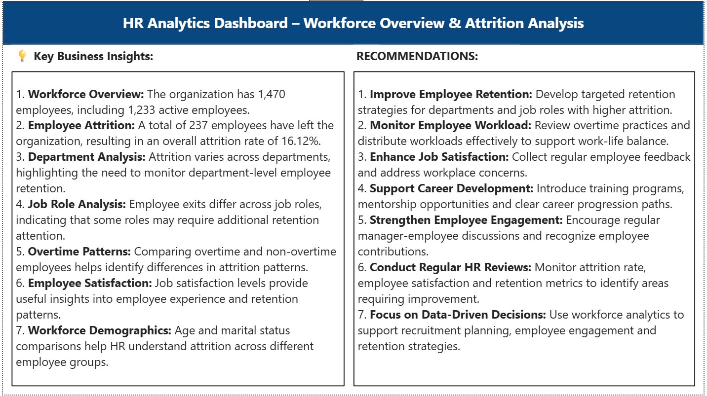

# 👥 HR Analytics – Employee Attrition & Workforce Insights

### End-to-End Data Analytics & Business Intelligence Project

An end-to-end Data Analytics project focused on analyzing employee workforce data, understanding employee attrition patterns, and identifying key HR insights to support better workforce planning and employee retention.

This project follows a complete analytics workflow using **Python for data preparation, MySQL for database management, SQL for business analysis, and Power BI for data modeling, KPI development, and interactive dashboard reporting.**

The final solution includes a **two-page interactive Power BI dashboard** featuring workforce overview, employee attrition analysis, key business insights, and actionable HR recommendations.

---

## 📌 Project Overview

Employee attrition is one of the important challenges organizations face because employee exits can affect workforce stability, recruitment planning, productivity, and overall business operations.

Understanding employee distribution and identifying patterns associated with employee attrition can help HR teams make better decisions.

The **HR Analytics – Employee Attrition & Workforce Insights** project transforms employee data into a meaningful business intelligence solution.

### Project Objectives

- Analyze overall employee workforce distribution.
- Calculate active employees and employee attrition.
- Identify department-wise attrition patterns.
- Analyze employee attrition across different job roles.
- Understand employee distribution by age group.
- Compare attrition between overtime and non-overtime employees.
- Analyze employee attrition across marital status groups.
- Develop interactive HR dashboards and KPI reports.
- Generate business insights and recommendations to improve employee retention.

---

## 🎯 Business Problem

Organizations need to understand their employee workforce and identify factors and patterns associated with employee attrition.

However, employee information can be difficult to interpret without proper data analysis and visualization.

The HR team needs an analytics solution to answer questions such as:

- How many employees are currently in the organization?
- How many employees have left the organization?
- What is the overall employee attrition rate?
- Which departments have higher employee attrition?
- Which job roles experience more employee exits?
- How does attrition differ between overtime and non-overtime employees?
- How does attrition vary across marital status groups?
- Which age groups represent the largest workforce segment?
- What actions can HR take to improve employee retention?

### Main Business Question

> **How can employee workforce data be analyzed to identify attrition patterns and provide actionable insights that support better HR decisions and employee retention?**

---

## 🛠️ Technology Stack

| Technology | Purpose |
|---|---|
| Python | Data preparation and analysis |
| Pandas | Data manipulation and transformation |
| NumPy | Numerical operations |
| MySQL | Database management |
| SQL | Business analysis and data querying |
| Power BI | Interactive dashboard development |
| Power Query | Data transformation |
| DAX | KPI calculations and business measures |
| GitHub | Project documentation and version control |

---

## 🔄 Project Workflow

```text
Raw HR Dataset
      ↓
Python Data Exploration & Cleaning
      ↓
Cleaned Employee Dataset
      ↓
MySQL Database
      ↓
SQL Business Analysis
      ↓
Power BI Data Modeling
      ↓
DAX Measures & KPI Development
      ↓
Interactive HR Analytics Dashboard
      ↓
Insights & Recommendations
```

---

## 📊 Dataset Summary

The project uses the **IBM HR Analytics Employee Attrition & Performance** dataset.

**Dataset Source:** [Kaggle – IBM HR Analytics Employee Attrition & Performance](https://www.kaggle.com/datasets/pavansubhasht/ibm-hr-analytics-attrition-dataset)

### Dataset Information

| Attribute | Details |
|---|---|
| Dataset Name | IBM HR Analytics Employee Attrition & Performance |
| Total Records | 1,470 |
| Original Columns | 35 |
| Data Type | Employee Workforce Data |
| Analysis Area | HR Analytics and Employee Attrition |

### Key Dataset Attributes

- EmployeeNumber
- Age
- Gender
- Department
- JobRole
- MaritalStatus
- MonthlyIncome
- TotalWorkingYears
- YearsAtCompany
- YearsInCurrentRole
- JobSatisfaction
- EnvironmentSatisfaction
- WorkLifeBalance
- OverTime
- Attrition

**Note:** This is a fictional employee dataset commonly used for HR analytics. It does not represent actual IBM employee records.

---

## 🐍 Data Preparation Using Python

Python was used to explore, clean, and prepare the raw employee dataset using a Jupyter Notebook.

### Activities Performed

- Loaded the original HR employee dataset using Pandas.
- Reviewed dataset structure and column information.
- Performed initial data exploration.
- Checked missing values and duplicate records.
- Examined column data types and unique values.
- Reviewed unnecessary and constant columns.
- Prepared the cleaned employee dataset for further analysis.
- Exported the cleaned data as a CSV file.

### Python Libraries

```python
import pandas as pd
import numpy as np
```

**Python Notebook:** `HR_DataSteps.ipynb`

The complete data preparation workflow is available in the Jupyter Notebook included in this repository.

---

## 🗄️ MySQL Database & SQL Analysis

The cleaned employee dataset was prepared for structured database analysis using MySQL.

SQL queries were used to explore employee information and generate business-level insights.

### SQL Analysis Areas

- Total employee count
- Active employee count
- Employee attrition count
- Overall attrition rate
- Department-wise employee distribution
- Department-wise attrition
- Job role-wise attrition
- Employee age group analysis
- Overtime and attrition analysis
- Employee tenure analysis
- Average monthly income
- Job satisfaction analysis

**SQL File:** `HR_Employee_Analysis.sql`

The SQL queries are included in the repository for reviewing the business analysis performed during the project.

---

## 📊 Power BI Data Modeling & DAX

Power BI was used to develop an interactive HR Analytics dashboard.

DAX measures were created to calculate important workforce KPIs and support employee attrition analysis.

### Key DAX Measures

**1. Total Employees**

```dax
Total Employees =
DISTINCTCOUNT(hr_employee[EmployeeNumber])
```

**2. Active Employees**

```dax
Active Employees =
CALCULATE(
    [Total Employees],
    hr_employee[Attrition] = "No"
)
```

**3. Attrition Count**

```dax
Attrition Count =
CALCULATE(
    [Total Employees],
    hr_employee[Attrition] = "Yes"
)
```

**4. Attrition Rate**

```dax
Attrition Rate =
DIVIDE(
    [Attrition Count],
    [Total Employees],
    0
)
```

### Key Performance Indicators (KPIs)

- Total Employees
- Active Employees
- Attrition Count
- Attrition Rate
- Average Monthly Income
- Average Tenure

---

# 📈 Power BI Dashboard

The final Power BI dashboard contains **two interactive pages** designed to provide a complete overview of employee workforce distribution, attrition patterns, and HR recommendations.

## 📊 Page 1 – Workforce Overview & Attrition Analysis

This page provides an overview of employee workforce metrics and attrition patterns across different employee categories.

### Key Performance Indicators (KPIs)

| KPI | Value |
|---|---:|
| Total Employees | 1,470 |
| Active Employees | 1,233 |
| Attrition Count | 237 |
| Attrition Rate | 16.12% |
| Average Monthly Income | Approximately 7K |
| Average Tenure | 7 Years |

### Dashboard Visualizations

**1. Employee Distribution by Department**

Displays employee distribution across:
- Research & Development
- Sales
- Human Resources

**2. Employee Distribution by Age Group**

Shows workforce distribution across different age categories:
- 35–50
- 25–34
- 51+
- Under 25

**3. Attrition by Department**

Compares employees who stayed and employees who left across different departments.

**4. Attrition by Job Role**

Analyzes employee attrition across different job roles to identify workforce retention patterns.

**5. Attrition by Overtime**

Compares overtime and non-overtime employees to understand differences in employee attrition.

**6. Attrition by Marital Status**

Analyzes employee attrition across:
- Married
- Single
- Divorced

### Interactive Filters

- Gender
- Department
- Job Role

### Dashboard Preview


---

## 💡 Page 2 – HR Insights & Recommendations

This page presents the key business findings from the employee analysis and provides practical recommendations to support better HR decision-making.

### Key Business Insights

- Overall workforce overview and employee distribution.
- Employee attrition count and attrition rate.
- Department-wise employee attrition patterns.
- Job role-wise employee exits.
- Overtime and employee workload patterns.
- Employee satisfaction and retention observations.
- Workforce demographics and marital status analysis.

### Recommended HR Actions

- Improve employee retention strategies.
- Monitor overtime and employee workload.
- Enhance employee satisfaction.
- Support employee career development.
- Strengthen employee engagement.
- Conduct regular HR performance reviews.
- Focus on data-driven workforce decisions.

### Dashboard Preview



---

## 📌 Key Business Insights

Based on the dashboard analysis, the following observations were identified:

**1. Strong Overall Workforce:** The organization has **1,470 employees**, including **1,233 active employees**, providing a clear overview of the workforce.

**2. Employee Attrition:** A total of **237 employees** have left the organization, resulting in an overall attrition rate of **16.12%**.

**3. Research & Development Has the Largest Workforce:** Research & Development has **961 employees**, followed by Sales with **446 employees** and Human Resources with **63 employees**.

**4. Department-wise Attrition:** Research & Development records the highest employee attrition count, followed by Sales, while Human Resources contributes the lowest attrition count.

**5. Job Role Analysis:** Employee exits vary across different job roles, highlighting the importance of monitoring role-specific retention patterns.

**6. Overtime Patterns:** Approximately **71.7% of employees do not work overtime**, while **28.3% work overtime**.

**7. Workforce Demographics:** Employees in the **35–50 age group** represent the largest workforce segment. Single employees also show the highest attrition count among the displayed marital status categories.

**8. Compensation and Tenure:** The dashboard reports an average monthly income of approximately **7K** and an average employee tenure of **7 years**.

*Note: These findings represent patterns observed in the available dataset and do not establish direct cause-and-effect relationships.*

---

## 🎯 Business Recommendations

**1. Improve Employee Retention:** Develop targeted retention strategies for departments and job roles with higher employee attrition.

**2. Monitor Employee Workload:** Review overtime practices and distribute workloads effectively to support work-life balance.

**3. Enhance Job Satisfaction:** Collect regular employee feedback and address workplace concerns to improve employee experience.

**4. Support Career Development:** Introduce training programs, mentorship opportunities, and clear career progression paths.

**5. Strengthen Employee Engagement:** Encourage regular manager-employee discussions and recognize employee contributions.

**6. Conduct Regular HR Reviews:** Monitor attrition rate, employee satisfaction, and retention metrics to identify areas requiring improvement.

**7. Focus on Data-Driven Decisions:** Use workforce analytics to support recruitment planning, employee engagement, and employee retention strategies.

---

## 📊 Skills Demonstrated

### Data Preparation – Python

- Data Exploration
- Data Cleaning
- Data Quality Checks
- Data Transformation
- Pandas
- NumPy

### Database & SQL

- MySQL Database Management
- SQL Queries
- Business Data Analysis
- Data Validation
- Aggregations and Grouping

### Power BI

- Data Modeling
- Power Query
- DAX Measures
- KPI Development
- Interactive Dashboards
- Slicers and Filters
- Data Visualization
- Business Reporting
- Insights & Recommendations

### Business & Analytical Skills

- Business Problem Understanding
- HR Analytics
- Employee Attrition Analysis
- Workforce Analysis
- Business Intelligence
- Data Storytelling
- Analytical Thinking
- Data-Driven Decision Making

---

## 📁 Repository Structure

```text
HR-Analytics-Employee-Attrition/
│
├── HR-Employee-Attrition.csv
│
├── hr_employee_cleaned.csv
│
├── HR_DataSteps.ipynb
│
├── HR_Employee_Analysis.sql
│
├── HR_Analytics_Dashboard.pbix
│
├── HR_Dashboard.png
│
├── HR_Insights_Recommendations.png
│
└── README.md
```

---

## 🚀 How to Run the Project

### Step 1 – Clone the Repository

```bash
git clone <your-github-repository-url>
```

Navigate to the project directory:

```bash
cd HR-Analytics-Employee-Attrition
```

### Step 2 – Run the Python Notebook

Install the required libraries:

```bash
pip install pandas numpy jupyter
```

Open the notebook:

```bash
jupyter notebook HR_DataSteps.ipynb
```

Run the notebook to explore and prepare the employee dataset.

### Step 3 – Perform SQL Analysis

1. Open MySQL Workbench.
2. Create or select your HR Analytics database.
3. Import the cleaned employee CSV file into a table.
4. Open `HR_Employee_Analysis.sql`.
5. Execute the SQL queries to analyze employee data.

### Step 4 – Open the Power BI Dashboard

Open:

```text
HR_Analytics_Dashboard.pbix
```

Then:

1. Review the employee dataset and data model.
2. Refresh the data if required.
3. Navigate through both dashboard pages.
4. Explore the KPIs and visualizations.
5. Use the available slicers to filter employee analysis.

---

## 🔮 Future Improvements

Possible future enhancements include:

- Building predictive employee attrition models.
- Developing employee retention risk segmentation.
- Integrating additional HR datasets.
- Automating data refresh and reporting.
- Adding advanced workforce planning metrics.
- Developing more detailed employee engagement analysis.

---

## 👨‍💻 Developed By

**Anil Kumar**

Aspiring Data Analyst | Python | SQL | Power BI | Excel

**GitHub:** https://github.com/thandaanil987

**LinkedIn:** https://linkedin.com/in/thanda-anil-kumar-5817172a5

---

## ⭐ Project Summary

This project demonstrates an end-to-end data analytics workflow, from employee data preparation and SQL business analysis to Power BI dashboard development and actionable HR recommendations.

**Python → MySQL → SQL → Power BI → DAX → Dashboard → Insights & Recommendations**

The project focuses on transforming employee workforce data into meaningful insights that support better HR analysis, workforce understanding, and employee retention strategies.

If you find this project useful, feel free to explore the repository and connect with me!
